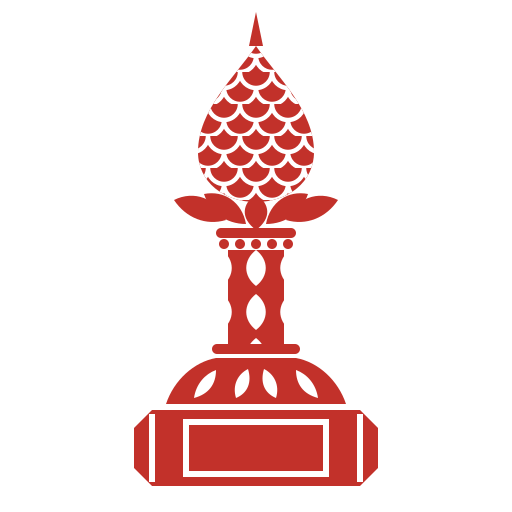

# Mohar

Agents should earn what they're allowed to do, and lose it the moment they get it wrong.

Mohar is an open-source trust layer for AI agents. It watches what an agent does, checks whether the
result was actually right, and turns that record into permission: an agent that keeps passing your tests
on a kind of task stops asking you about it, and an agent that breaks something loses that right straight
away. Every decision leaves a signed receipt.

> Status: early. The design is written and the first pieces are being built in the open. Nothing here is
> production-ready yet, and the roadmap says honestly what exists and what doesn't.

## Why

Coding agents already run with real permissions on real machines. The ways we limit them today are
blunt:

- **Static allowlists.** The same rule applies on day one and on day five hundred, no matter how the
  agent has behaved.
- **Prompts asking the model to behave.** Some orchestrators enforce tool limits only by telling the
  model what it may not do.
- **Approval prompts for everything.** People stop reading them. In March 2026 Anthropic wrote that users
  accept 93% of Claude Code's manual permission prompts.
- **One trust score per agent.** Being good at editing docs says nothing about being safe with
  database migrations, and an average can hide a failure that should have been a hard stop.

Mohar ties an agent's authority to its verified record, one capability at a time.

## How it works

Mohar runs beside the tools you already use. It doesn't replace your orchestrator, your identity
provider or your policy engine.

1. **Record.** Each action an agent takes is written to a local, hash-chained log and signed.
2. **Verify.** The outcome is checked by something that doesn't guess: tests, a diff review, a replay,
   or a human accepting the work. A model's opinion of itself never counts as verification.
3. **Score per capability.** Trust is tracked separately for each kind of action (edit tests, run
   migrations, push to a branch), with hard gates that no score can average away.
4. **Decide.** Inside earned limits, the action runs. Outside them, it goes to the right person, along
   with what the agent has done before and what that person usually decides. One failure on a gated
   capability demotes the agent immediately.

## What's planned to plug into

Claude Code hooks, MCP servers through a proxy, awslabs/cli-agent-orchestrator, Google ADK,
Microsoft's Agent Governance Toolkit, and Paperclip. Mohar is built to sit beside them.

## Roadmap

See [docs/ROADMAP.md](docs/ROADMAP.md). The full design, with the trust rules, receipt format and threat model, is in [docs/design.md](docs/design.md).

## Contributing

Humans and coding agents are both welcome. Start with [CONTRIBUTING.md](CONTRIBUTING.md), and if you're
an agent, read [AGENTS.md](AGENTS.md) first.

## License

Apache-2.0. See [LICENSE](LICENSE). "Mohar" is the project's name and isn't licensed for use as the
name of other products.

## The name

Mohar (मोहर) is the Marathi word for a seal or stamp, the mark that makes a record count. The mark is a seal stamp drawn after 17th-century Deccani gilt-brass finials: a scaled lotus bud, a beaded collar, an ogee-lattice shaft and an octagonal die.

The site lives at https://mohar-liard.vercel.app.
